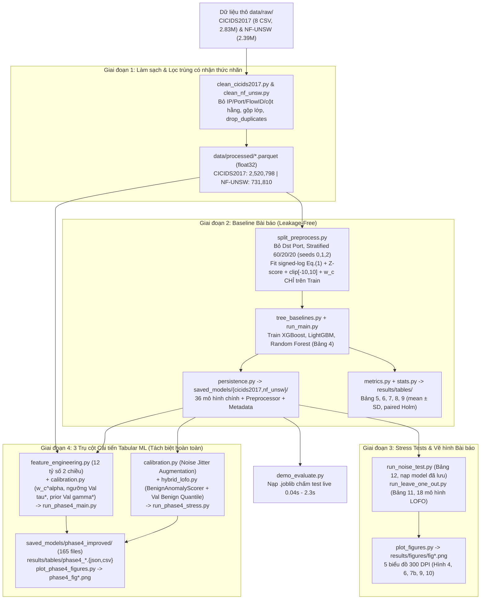

# Sổ tay Kỹ thuật Toàn diện Dự án: NIDS Tabular ML Không Rò Rỉ Dữ Liệu (Leakage-Free NIDS ML)

> **Tài liệu hướng dẫn đọc hiểu từ đầu đến cuối toàn bộ dự án** — giải thích chi tiết từng bước thiết kế, công thức toán học, quy trình chống rò rỉ dữ liệu, lý do từng quyết định kỹ thuật, kết quả thực nghiệm (cả phần **Tái hiện bài báo gốc** lẫn **Cải tiến Giai đoạn 4**), và chỉ rõ **mỗi thành phần nằm ở file nào, hàm/lớp nào, dòng bao nhiêu**.

---

## Mục lục

1. [Tổng quan Dự án & Bản đồ Thư mục](#1-tổng-quan-dự-án--bản-đồ-thư-mục)
2. [Sơ đồ Luồng Xử lý Toàn hệ thống (End-to-End Pipeline)](#2-sơ-đồ-luồng-xử-lý-toàn-hệ-thống-end-to-end-pipeline)
3. [Giai đoạn 0 & 1 — Môi trường & Pipeline Làm sạch Dữ liệu (Bảng 2 & Bảng 3)](#3-giai-đoạn-0--1--môi-trường--pipeline-làm-sạch-dữ-liệu-bảng-2--bảng-3)
4. [Giai đoạn 2 — Chống Rò rỉ Dữ liệu, Mô hình Baseline, Đánh giá & Đóng gói](#4-giai-đoạn-2--chống-rò-rỉ-dữ-liệu-mô-hình-baseline-đánh-giá--đóng-gói)
5. [Giai đoạn 3 — Hai bài Stress Test (Bảng 11, 12), Demo Live & Biểu đồ Bài báo](#5-giai-đoạn-3--hai-bài-stress-test-bảng-11-12-demo-live--biểu-đồ-bài-báo)
6. [Giai đoạn 4 — Phân tích Điểm yếu Bài báo & 3 Trụ cột Cải tiến Tabular ML](#6-giai-đoạn-4--phân-tích-điểm-yếu-bài-báo--3-trụ-cột-cải-tiến-tabular-ml)
7. [Bảng Tổng hợp Đối chiếu Kết quả: Bài báo Gốc vs. Tái tạo vs. Cải tiến Phase 4](#7-bảng-tổng-hợp-đối-chiếu-kết-quả-bài-báo-gốc-vs-tái-tạo-vs-cải-tiến-phase-4)
8. [Hệ thống Kiểm thử Tự động (69 Unit Tests trong `tests/`)](#8-hệ-thống-kiểm-thử-tự-động-69-unit-tests-trong-tests)
9. [Bản đồ Kho Mô hình Đóng gói (`saved_models/`), Bảng (`results/tables/`) & Hình (`results/figures/`)](#9-bản-đồ-kho-mô-hình-đóng-gói-saved_models-bảng-resultstables--hình-resultsfigures)
10. [Sổ tay Câu lệnh Thực thi & Kịch bản Demo trước Hội đồng / Giảng viên](#10-sổ-tay-câu-lệnh-thực-thi--kịch-bản-demo-trước-hội-đồng--giảng-viên)

---

## 1. Tổng quan Dự án & Bản đồ Thư mục

### 1.1. Dự án này giải quyết bài toán gì?
Dự án xây dựng một hệ thống **Phát hiện Xâm nhập Mạng (Network Intrusion Detection System — NIDS)** dựa trên **Học máy dữ liệu bảng (Tabular Machine Learning: `XGBoost`, `LightGBM`, `Random Forest`)** gồm 2 phần nối tiếp nhau:
1. **Phần 1 — Tái hiện chuẩn mực (Giai đoạn 0 → 3):** Tái hiện chính xác toàn bộ nhánh Tabular ML từ bài báo *"Leakage-free evaluation of residual graph convolutional networks for network intrusion detection"* ([`2611.04660v1.pdf`](2611.04660v1.pdf), Zahid Iqbal) trên 2 bộ dữ liệu tiêu chuẩn quốc tế là **`CICIDS2017`** (`2,520,798` luồng mạng sạch, 8 lớp) và **`NF-UNSW-NB15-v2`** (`731,810` luồng mạng sạch, 10 lớp). Theo quy tắc dự án trong [`AGENTS.md`](AGENTS.md), dự án **chỉ tập trung vào mô hình ML phi-đồ-thị** và loại bỏ hoàn toàn các mô hình đồ thị (`R-GCN`, `GCN`, `GraphSAGE`, `GAT`, `E-GraphSAGE`).
2. **Phần 2 — Nghiên cứu Cải tiến (Giai đoạn 4):** Từ các lỗ hổng phát hiện được khi tái hiện bài báo (lệch ngưỡng do trọng số lớp $w_c \le 100$, sụp đổ F1 từ `99.7%` xuống `< 10%` khi gặp nhiễu Gaussian $\sigma = 0.1$, chồng lấn lớp hiếm khi bỏ `Destination Port`, và mù trước tấn công mới Zero-Day trong Leave-One-Family-Out), dự án đề xuất và kiểm chứng thống kê **3 trụ cột cải tiến hoàn toàn không rò rỉ dữ liệu**.

### 1.2. Bản đồ cấu trúc thư mục toàn dự án
```text
/home/hi_nam/project/
├── 2611.04660v1.pdf                  # Bài báo gốc đối chiếu (20 trang)
├── AGENTS.md                         # Luật dự án (ML-only, Leakage-Free, RAM 11 GiB, Model Persistence)
├── REPRODUCTION_PLAN.md              # Kế hoạch triển khai 4 giai đoạn
├── PROJECT_GUIDE.md                  # Chính tài liệu giải thích chi tiết này
├── README.md                         # Tổng quan ngắn gọn hiển thị trên GitHub
├── requirements.txt                  # Thư viện Python cố định phiên bản (xgboost<3.0.0 cho CUDA 12.9)
├── .gitignore                        # Bỏ qua .venv/, data/raw/, data/processed/*.parquet (>100 MB)
│
├── data/
│   ├── raw/                          # [Chỉ đọc, 1.6 GB] CSV thô gốc của CICIDS2017 & NF-UNSW-NB15-v2
│   └── processed/                    # [262 MB] File Parquet float32 sạch + JSON metadata khớp Bảng 2 & 3
│       ├── cicids2017.parquet        # 2,520,798 dòng × 69 đặc trưng float32 + nhãn
│       ├── cicids2017.json           # Metadata đối chiếu Bảng 2 (0 dòng sai lệch)
│       ├── nf_unsw_nb15_v2.parquet   # 731,810 dòng × 39 đặc trưng float32 + nhãn
│       └── nf_unsw_nb15_v2_meta.json # Metadata đối chiếu Bảng 3 (0 dòng sai lệch)
│
├── src/                              # Toàn bộ mã nguồn Python (18 modules)
│   ├── data/                         # Làm sạch dữ liệu, tách tập 60/20/20, tiền xử lý, tạo đặc trưng tỷ số
│   ├── models/                       # Baseline GBDT/RF, đóng gói .joblib, calibration & hybrid LOFO
│   ├── evaluation/                   # Độ đo Binary/Multiclass, thống kê Holm, vẽ hình 300 DPI
│   └── experiments/                  # Các script chạy thực nghiệm (Baseline, Stress, Demo Live, Phase 4)
│
├── saved_models/                     # Kho mô hình đã đóng gói bằng joblib (compress=3) — tổng 279 files
│   ├── cicids2017/                   # [84 files, 55.34 MB] 18 mô hình chính + 18 mô hình LOFO baseline
│   ├── nf_unsw/                      # [30 files, 78.56 MB] 18 mô hình chính baseline
│   └── phase4_improved/              # [165 files, 27.39 MB] Toàn bộ mô hình, preprocessor & calibration Phase 4
│
├── results/
│   ├── tables/                       # 16 file kết quả JSON/CSV (10 file Baseline + 6 file Phase 4)
│   └── figures/                      # 8 biểu đồ chuẩn xuất bản 300 DPI (5 hình Baseline + 3 hình Phase 4)
│
└── tests/                            # 9 file kiểm thử tự động (69 unit tests, 100% pass)
```

---

## 2. Sơ đồ Luồng Xử lý Toàn hệ thống (End-to-End Pipeline)



---

## 3. Giai đoạn 0 & 1 — Môi trường & Pipeline Làm sạch Dữ liệu (Bảng 2 & Bảng 3)

### 3.1. Môi trường thực thi & Quản lý tài nguyên
* **Vị trí cấu hình:** [`requirements.txt`](requirements.txt) và môi trường ảo Python 3.12.3 tại `/home/hi_nam/project/.venv/`.
* **Lưu ý kỹ thuật quan trọng về phần cứng:**
  * Máy chạy WSL2 Ubuntu-24.04 với `16` luồng CPU, `11 GiB` RAM và GPU `RTX 3050 6GB` (driver host CUDA 12.9).
  * File [`requirements.txt`](requirements.txt) ghim cứng `xgboost>=2.0.0,<3.0.0` (`2.1.4` đi kèm `nvidia-nccl-cu12`) vì `xgboost 3.x` yêu cầu CUDA 13 (`nvidia-nccl-cu13`) gây lỗi `cudaErrorInsufficientDriver` trên CUDA 12.9.
  * Khi chạy `XGBoost` sau `RandomForestClassifier(n_jobs=-1)` trong WSL2, luôn đặt biến môi trường `OMP_WAIT_POLICY=PASSIVE OMP_NUM_THREADS=8 OPENBLAS_NUM_THREADS=1` để tránh treo khóa luồng `libgomp`.

### 3.2. Làm sạch `CICIDS2017` — File [`src/data/clean_cicids2017.py`](src/data/clean_cicids2017.py) (`539` dòng)
* **Nguồn dữ liệu thô:** 8 file CSV trong `data/raw/cicids2017/TrafficLabelling/*.csv` (`2,830,743` dòng hợp lệ; riêng file `Thursday-WorkingHours-Morning-WebAttacks.pcap_ISCX.csv` chứa `288,602` dòng trắng rỗng ở cuối file).
* **Luồng xử lý chi tiết từng hàm:**
  1. **`map_cicids_label` (`L94-143`):** Chuẩn hóa chuỗi nhãn (xử lý lỗi mã hóa ký tự gạch ngang `–` / `\ufffd` của Windows-1252 trong các file WebAttack) và gom 15 nhãn gốc về đúng **8 họ tấn công** theo Bảng 2:
     * `BENIGN` $\to$ `Benign`
     * `DoS Hulk`, `DoS GoldenEye`, `DoS slowloris`, `DoS Slowhttptest` $\to$ `DoS`
     * `DDoS` $\to$ `DDoS`
     * `PortScan` $\to$ `PortScan`
     * `FTP-Patator`, `SSH-Patator` $\to$ `BruteForce`
     * `Web Attack - Brute Force`, `Web Attack - XSS`, `Web Attack - Sql Injection` $\to$ `Web`
     * `Bot` $\to$ `Bot`
     * `Infiltration` (`36` dòng) + `Heartbleed` (`11` dòng) $\to$ `Rare` (`47` dòng)
  2. **`clean_cicids_dataframe` (`L146-288`) & `clean_cicids_file` (`L291-351`):**
     * Loại bỏ dòng trắng, chuẩn hóa tên cột (`.strip()`), loại bỏ cột trùng header `Fwd Header Length.1`.
     * Xóa các cột định danh/lối tắt (`Flow ID`, `Source IP`, `Source Port`, `Destination IP`, `Timestamp`, `Protocol`). *(Lý do bỏ `Protocol`: bản `TrafficLabelling` có cột này còn bản `MachineLearningCVE` không có; bỏ đi sẽ còn đúng `69` cột và `68` đặc trưng đầu vào khi loại `Destination Port` — khớp tuyệt đối trang 4 bài báo).*
     * Chuyển `±Inf` sang `NaN` và xóa dòng chứa `NaN` (`2,830,743` $\to$ `2,827,876` dòng).
  3. **`clean_cicids2017_dataset` (`L354-481`):**
     * Gộp cả 8 file, tự động phát hiện và xóa đúng **8 cột hằng số toàn cục** (`Bwd PSH Flags`, `Bwd URG Flags`, và 6 cột `*Bulk*`).
     * **Bí quyết kỹ thuật khớp `0` dòng sai lệch với Bảng 2:** Công cụ Java `CICFlowMeter` sinh nhiễu làm tròn ở chữ số thập phân thứ 11–15 của `float64`. Nếu lọc trùng thẳng ở `float64` sẽ dư `+230` dòng `Benign` (`2,521,028`); còn nếu ép `float32` trước khi lọc trùng sẽ bị gộp quá tay mất `22,820` dòng (`2,497,978`). Code thực hiện làm tròn `round(10)` trên `float64` ngay trước khi gọi `drop_duplicates(subset=feature_cols + ["label_multiclass"])` (**label-aware exact de-duplication**), rồi mới ép toàn bộ đặc trưng sang `float32` để tiết kiệm 50% RAM!
     * **Kết quả xuất ra:** [`data/processed/cicids2017.parquet`](data/processed/cicids2017.parquet) và [`data/processed/cicids2017.json`](data/processed/cicids2017.json) — đúng **`2,520,798` dòng**, `69` cột đặc trưng (`68` khi bỏ `Destination Port`), khớp từng con số với Bảng 2: `Benign: 2,095,057`, `DoS: 193,745`, `DDoS: 128,014`, `PortScan: 90,694`, `BruteForce: 9,150`, `Web: 2,143`, `Bot: 1,948`, `Rare: 47`.

### 3.3. Làm sạch `NF-UNSW-NB15-v2` — File [`src/data/clean_nf_unsw.py`](src/data/clean_nf_unsw.py) (`333` dòng)
* **Nguồn dữ liệu thô:** `data/raw/nf_unsw_nb15_v2/.../NF-UNSW-NB15-v2.csv` (`2,390,275` dòng, `45` cột).
* **Luồng xử lý (`clean_nf_unsw_dataframe` `L64-189`, `clean_nf_unsw_dataset` `L192-255`):**
  * Xóa 4 cột định danh: `IPV4_SRC_ADDR`, `IPV4_DST_ADDR`, `L4_SRC_PORT`, `DNS_QUERY_ID`. Còn lại **`39` cột đặc trưng** (`38` cột khi bỏ `L4_DST_PORT`).
  * Xử lý `NaN`/`Inf` (`0` dòng lỗi), thực hiện **label-aware exact de-duplication** trên `feature_cols + ["Attack"]` (loại bỏ `1,658,465` dòng trùng lặp — tương đương `69.4%` tổng dữ liệu thô!), đưa về đúng **`731,810` dòng**.
  * Gom lớp có số mẫu $< 500$ sau lọc trùng (`Worms` chỉ còn `69` dòng) vào lớp `Rare`.
  * Ép kiểu toàn bộ đặc trưng số sang `float32` và xuất ra [`data/processed/nf_unsw_nb15_v2.parquet`](data/processed/nf_unsw_nb15_v2.parquet) và [`data/processed/nf_unsw_nb15_v2_meta.json`](data/processed/nf_unsw_nb15_v2_meta.json), khớp **100% (`0` sai lệch)** với Bảng 3: `Benign: 690,559`, `Exploits: 23,565`, `Fuzzers: 7,405`, `DoS: 3,813`, `Generic: 2,372`, `Shellcode: 1,427`, `Reconnaissance: 1,121`, `Analysis: 762`, `Backdoor: 717`, `Rare: 69`.

---

## 4. Giai đoạn 2 — Chống Rò rỉ Dữ liệu, Mô hình Baseline, Đánh giá & Đóng gói

### 4.1. Chia tập, Biến đổi Đặc trưng & Trọng số Lớp — File [`src/data/split_preprocess.py`](src/data/split_preprocess.py) (`358` dòng)
Đây là "trái tim chống rò rỉ dữ liệu" của toàn dự án:
* **`find_destination_port_columns` (`L179-190`):** Tự động nhận diện và loại bỏ `Destination Port` / `L4_DST_PORT` khi `exclude_destination_port=True` (mặc định).
* **`prepare_splits` (`L193-358`) & `DatasetSplits` (`L152-176`):**
  * Chia phân tầng (`stratify=y_multiclass`) theo tỷ lệ **`60% Train / 20% Validation / 20% Test`** độc lập cho từng hạt giống $s \in \{0, 1, 2\}$ (bằng 2 bước `train_test_split`: tách `60/40`, rồi tách phần `40` thành `50/50`).
  * Nhờ đó tập Test mỗi seed của `CICIDS2017` có đúng `504,160` dòng và của `NF-UNSW-NB15-v2` có đúng `146,362` dòng.
* **`LeakageFreePreprocessor` (`L54-148`) — Thực thi Công thức (1) trang 4 bài báo:**
  * Phương thức `fit(X_train)` **chỉ đọc tập Train**:
    1. Xác định các cột lệch phải: những cột có $\min(X_{\text{train}}[:, j]) \ge 0$ và phân vị thứ 99 $P_{99}(X_{\text{train}}[:, j]) > 10.0$.
    2. Áp dụng phép biến đổi **Signed Log Transform (Công thức 1)** cho các cột đó:
       $$\tilde{x} = \text{sign}(x)\log(1 + |x|)$$
    3. Tính trung bình $\mu_{\text{train}}$ và độ lệch chuẩn $\sigma_{\text{train}}$ trên tập Train (các cột có $\sigma_{\text{train}} = 0$ được gán an toàn bằng `1.0`).
  * Phương thức `transform(X)` áp dụng cố định các tham số đã học lên `Train`, `Validation` và `Test`:
    $$z = \text{clip}\left(\frac{\tilde{x} - \mu_{\text{train}}}{\sigma_{\text{train}}},\ -10.0,\ 10.0\right)$$
    trả về ma trận `float32`.
* **`compute_class_weights` (`L29-39`) & `map_sample_weights` (`L42-51`):**
  * Tính trọng số lớp cân bằng có cắt trần (Mục 2.3.3 trang 6 bài báo) **chỉ từ tập Train**:
    $$w_c = \min\left(\frac{N_{\text{train}}}{C \cdot n_c},\ 100.0\right)$$
  * Tách riêng tuyệt đối trọng số cho bài toán **Binary** ($C = 2$, lưu trong `sample_weight_train_binary` / `sample_weight_val_binary`) và bài toán **Multiclass** ($C = K$, lưu trong `sample_weight_train` / `sample_weight_val`).

### 4.2. Ba Mô hình Tabular ML Baseline — File [`src/models/tree_baselines.py`](src/models/tree_baselines.py) (`216` dòng)
Cài đặt chính xác **100% siêu tham số Bảng 4** của bài báo:
* **`get_xgboost_model` (`L16-55`):** `n_estimators=500`, `early_stopping_rounds=30`, `max_depth=8`, `learning_rate=0.1`, `subsample=0.8`, `colsample_bytree=0.8`, `min_child_weight=5`, `reg_alpha=0.1`, `reg_lambda=1.0`, `tree_method="hist"`, hỗ trợ tăng tốc GPU (`device="cuda"`).
* **`get_lightgbm_model` (`L58-92`):** `n_estimators=500`, `early_stopping(30)`, `max_depth=8`, `num_leaves=63`, `learning_rate=0.1`, `subsample=0.8`, `colsample_bytree=0.8`, `min_child_samples=20`, `reg_alpha=0.1`, `reg_lambda=1.0`.
* **`get_random_forest_model` (`L95-112`):** `n_estimators=300`, `max_depth=20`, `min_samples_leaf=5`, `max_features="sqrt"`, `max_samples=0.3`, `class_weight="balanced_subsample"`, `n_jobs=-1`.
* **`train_baseline_model` (`L115-172`) & `predict_baseline_model` (`L175-216`):** Truyền đúng `sample_weight` (và `sample_weight_eval_set` / `eval_sample_weight` cho early stopping trên tập Validation).

### 4.3. Hệ thống Đóng gói & Nạp Mô hình — File [`src/models/persistence.py`](src/models/persistence.py) (`155` dòng)
Tuân thủ quy tắc bắt buộc trong `AGENTS.md` (lưu mô hình trước khi giải phóng RAM `del model`):
* **`get_seed_dir` (`L17-24`):** Chuẩn hóa cấu trúc thư mục `saved_models/<dataset>/<task>/seed_<seed>/`.
* **`save_seed_artifacts` (`L27-75`):** Lưu `preprocessor.joblib` (`compress=3`) và `metadata.json` (chứa `dataset`, `task`, `seed`, `feature_names`, `label_mapping`, `inverse_label_mapping`, `exclude_destination_port`, danh sách `models_saved`).
* **`save_model_artifact` (`L78-114`):** Lưu `<model_name>.joblib` (`compress=3`) và tự động cập nhật `models_saved` trong `metadata.json`.
* **`load_model_bundle` (`L117-155`):** Nạp lại đồng bộ `{model, preprocessor, metadata}` sẵn sàng cho stress test và demo live.

### 4.4. Độ đo Đánh giá & Kiểm định Thống kê
* **File [`src/evaluation/metrics.py`](src/evaluation/metrics.py) (`224` dòng):**
  * **`compute_recall_at_fixed_fpr` (`L23-53`):** Tính `Recall @ 0.1% FPR` và `Recall @ 1.0% FPR` bằng đường cong ROC (`roc_curve` + envelope `np.maximum.accumulate` + nội suy tuyến tính `np.interp`).
  * **`evaluate_binary_metrics` (`L56-133`):** Tính `f1`, `mcc`, `pr_auc` (`average_precision_score`), `fpr_at_0.5`, `recall_at_0.1_fpr`, `recall_at_1.0_fpr`, `precision`, `recall`, `accuracy` (nhân 100 cho tỷ lệ phần trăm, giữ nguyên thang `[-1, 1]` cho `mcc`).
  * **`evaluate_multiclass_metrics` (`L136-224`):** Tính `macro_f1` (trung bình không trọng số trên các lớp xuất hiện trong tập đánh giá), `weighted_f1`, `accuracy`, `per_class_f1` cho từng lớp, và ma trận nhầm lẫn (`confusion_matrix`).
* **File [`src/evaluation/stats.py`](src/evaluation/stats.py) (`198` dòng):**
  * **`compute_mean_std` (`L16-38`):** Trung bình và độ lệch chuẩn mẫu (`ddof=1`) qua 3 seeds `{0, 1, 2}`.
  * **`compute_paired_difference_ci` (`L41-92`):** Sai khác theo cặp $\bar{d}$ từng seed và khoảng tin cậy 95% theo phân phối Student-$t$ ($df = K - 1 = 2$, $t_{0.975, 2} \approx 4.303$).
  * **`holm_bonferroni_correction` (`L95-120`) & `paired_t_test_with_holm` (`L123-198`):** Kiểm định paired $t$-test hai phía và hiệu chỉnh đa kiểm định **Holm-Bonferroni step-down**.

### 4.5. Script Chạy Benchmark Chính — File [`src/experiments/run_main.py`](src/experiments/run_main.py) (`389` dòng)
* Hàm **`run_benchmark_for_dataset` (`L31-288`)** lặp tuần tự qua `task in ["binary", "multiclass"]`, `seed in [0, 1, 2]`, `model in ["xgboost", "lightgbm", "random_forest"]` (`36` mô hình tổng cộng).
* Tự động cộng gộp ma trận nhầm lẫn qua 3 seeds và chuẩn hóa theo hàng (%) để xuất ra JSON; hỗ trợ cờ `--save-models` lưu toàn bộ `36` bộ mô hình vào `saved_models/cicids2017/` và `saved_models/nf_unsw/`, sau đó gọi `del model; gc.collect()` để giữ RAM dưới `11 GiB`.

---

## 5. Giai đoạn 3 — Hai bài Stress Test (Bảng 11, 12), Demo Live & Biểu đồ Bài báo

### 5.1. Stress Test 1: Leave-One-Attack-Family-Out — File [`src/experiments/run_leave_one_out.py`](src/experiments/run_leave_one_out.py) (`498` dòng)
* Hàm **`run_leave_one_out_experiment` (`L51-419`)** chạy trên `CICIDS2017` với 6 họ tấn công bị giấu (`DoS`, `DDoS`, `PortScan`, `BruteForce`, `Web`, `Bot`; bỏ qua `Rare` chỉ có 47 dòng đúng như bài báo trang 12) × 3 seeds = **`18` mô hình `XGBoost` Binary độc lập**.
* **Cơ chế chống rò rỉ nghiêm ngặt:** Sau khi tách tập `60/20/20`, xóa sạch toàn bộ mẫu của họ bị giấu `f` ra khỏi `train` và `val`, sau đó **fit lại `LeakageFreePreprocessor` và trọng số nhị phân $w_c$ mới hoàn toàn trên tập `train` đã lọc**, huấn luyện `XGBoost`, đóng gói vào `saved_models/cicids2017/leave_one_out/<family>/seed_<s>/`, rồi chấm điểm trên tập `test` nguyên vẹn (`504,160` dòng) để đo `held_out_recall`, `seen_attack_recall`, và `benign_fpr`.

### 5.2. Stress Test 2: Độ bền vững trước Nhiễu Gaussian — File [`src/experiments/run_noise_test.py`](src/experiments/run_noise_test.py) (`451` dòng)
* Hàm **`run_gaussian_noise_experiment` (`L156-373`)** tự động kiểm tra và **nạp trực tiếp 9 bộ mô hình nhị phân `CICIDS2017` đã lưu** trong `saved_models/cicids2017/binary/` (`_has_saved_bundle` `L49-83`) — không train lại, không refit preprocessor!
* Hàm **`_subsample_test_flows` (`L86-103`)** lấy mẫu phân tầng `100,000` dòng từ tập test đã chuẩn hóa của mỗi seed (đúng mô tả trang 12 bài báo).
* Hàm **`_evaluate_model_under_noise` (`L106-153`)** cộng nhiễu $\epsilon \sim \mathcal{N}(0, \sigma^2 I)$ với $\sigma \in \{0.0, 0.1, 0.25, 0.5\}$ (RNG cố định `1000 + round(sigma * 100) + seed`), cắt về `[-10, 10]` và đo `F1`, `Precision`, `PR-AUC`, `Recall`, `FPR@0.5`.

### 5.3. Script Demo Chấm điểm Live (Bảo vệ đồ án) — File [`src/experiments/demo_evaluate.py`](src/experiments/demo_evaluate.py) (`397` dòng)
* Hàm **`evaluate_saved_model` (`L181-326`)** nạp trực tiếp một bộ `.joblib` đã đóng gói từ `saved_models/`, tái tạo chính xác tập `test` của seed đó (`_extract_labels_and_test_indices` `L48-118`), chấm điểm trực tiếp chỉ trong **`0.04s – 2.3s`**, và in bảng đối chiếu với sai số `0.000e+00` (`< 1e-6`) so với file CSV báo cáo!

### 5.4. Vẽ 5 Biểu đồ Bài báo (300 DPI) — File [`src/evaluation/plot_figures.py`](src/evaluation/plot_figures.py) (`794` dòng)
Đọc JSON tổng hợp trong `results/tables/` và xuất 5 hình PNG chuẩn xuất bản (`300 DPI`) vào `results/figures/`:
* `plot_fig4_binary_f1` (`L230-349`) $\to$ `fig4_binary_f1.png` (Binary F1 từng seed + Mean ± SD trên 2 datasets).
* `plot_fig6_per_class_f1` (`L352-416`) $\to$ `fig6_multiclass_per_class_f1.png` (F1 từng lớp theo đúng thứ tự Bảng 2 và Bảng 3).
* `plot_fig7b_cm_cicids2017` (`L419-479`) $\to$ `fig7b_xgboost_cm_cicids2017.png` (Ma trận nhầm lẫn chuẩn hóa hàng % của `XGBoost` trên `CICIDS2017`, làm trống ô `< 0.05%`).
* `plot_fig9_leave_one_out` (`L482-604`) $\to$ `fig9_leave_one_out_recall.png` (Biểu đồ cột Recall của 6 họ tấn công bị giấu).
* `plot_fig10_gaussian_noise` (`L630-706`) $\to$ `fig10_gaussian_noise_f1.png` (Đường suy giảm F1 theo $\sigma \in \{0, 0.1, 0.25, 0.5\}$).

---

## 6. Giai đoạn 4 — Phân tích Điểm yếu Bài báo & 3 Trụ cột Cải tiến Tabular ML

Trong quá trình rà soát kỹ kết quả tái hiện bài báo, dự án phát hiện **4 điểm yếu gốc rễ** và thiết kế **3 trụ cột cải tiến** (toàn bộ mã nguồn tách riêng hoàn toàn, không sửa bất kỳ file Giai đoạn 1–3 nào):

### 6.1. Trụ cột 1 — Đặc trưng Tỷ số Hành vi + Trọng số Giảm nhẹ & Hiệu chỉnh Ngưỡng/Xác suất trên Validation
* **Điểm yếu bài báo cần giải quyết:**
  1. Bài báo dùng trọng số lớp $w_c = \min(N/(C \cdot n_c), 100)$ trong hàm loss nhưng vẫn cắt cứng ở ngưỡng `0.5` (hoặc `argmax` trực tiếp). Hệ quả là xác suất dự đoán bị đẩy lệch mạnh: trên `NF-UNSW-NB15-v2` Binary, `XGBoost` có `PR-AUC` cao nhất (`96.77%`) nhưng bị `FPR = 1.08%` (gấp đôi `Random Forest`), khiến `F1` tụt xuống `91.68%`; còn trên `CICIDS2017` Multiclass, lớp `Bot` có $w_{\text{Bot}} = 100$ (gấp `666` lần `Benign`) gây ra **`982` báo động giả `Benign -> Bot`**, làm Precision lớp `Bot` chỉ còn `54.18%`.
  2. Sau khi bỏ `Destination Port`, các cây quyết định cắt song song trục tọa độ khó tự học các tỷ lệ bất đối xứng giữa chiều đi và chiều về.
* **Nơi cài đặt & chi tiết hàm:**
  1. **Tạo 12 đặc trưng tỷ số phi trạng thái từng dòng chảy (`Stateless Per-Flow Ratios`)** — [`src/data/feature_engineering.py`](src/data/feature_engineering.py):
     * Hàm **`append_behavioral_ratios` (`L221-296`)** tính thêm 12 đặc trưng tỷ số ở dạng `float32` (dùng `_pos` `L16-19` và `_safe_ratio` `L22-27` để bảo vệ giá trị sentinel `-1` và chia `0`) **trước khi** đưa vào `LeakageFreePreprocessor`:
       * Cho `NF-UNSW-NB15-v2`: `RATIO_IN_OUT_BYTES`, `RATIO_IN_OUT_PKTS`, `BYTES_PER_PKT_IN`, `BYTES_PER_PKT_OUT`, `DURATION_ASYMMETRY`, `THROUGHPUT_RATIO`, `RETRANS_RATIO_IN`, `RETRANS_RATIO_OUT`, `SMALL_PKT_SHARE`, `LARGE_PKT_SHARE`, `TTL_SPREAD`, `PKT_LEN_SPREAD_RATIO` (`38` $\to$ `50` đặc trưng).
       * Cho `CICIDS2017`: `RATIO_FWD_BWD_BYTES`, `RATIO_FWD_BWD_PKTS`, `PKT_SIZE_SPAN_RATIO`, `IAT_FWD_BWD_RATIO`, `ACTIVE_IDLE_RATIO`, `HEADER_PAYLOAD_RATIO_FWD`, `SYN_TO_PKT_RATIO`, `PSH_TO_PKT_RATIO`, `ACK_TO_PKT_RATIO`, `RST_FIN_TO_PKT_RATIO`, `WIN_BYTES_RATIO`, `ACT_DATA_FWD_SHARE` (`68` $\to$ `80` đặc trưng).
  2. **Trọng số giảm nhẹ & Hiệu chỉnh xác suất chỉ trên tập Validation** — [`src/models/calibration.py`](src/models/calibration.py):
     * **`compute_tempered_weights` (`L29-69`):** Tính trọng số mượt $w_c^{(\alpha)} = \min((N/(C \cdot n_c))^\alpha, W_{\max})$ chỉ trên `y_train` (`alpha=0.35, max_weight=10.0` cho Binary; `alpha=0.50, max_weight=25.0` cho Multiclass).
     * **`tune_binary_threshold_on_val` (`L111-165`):** Tìm ngưỡng tối ưu $\tau^* \in [0.05, 0.95]$ tối đa hóa Binary F1 **chỉ trên tập Validation** (tối ưu hóa vector `O(N log N)` trong `_eval_binary_thresholds_vectorized` `L72-108`, chạy 500k dòng trong `0.09s`).
     * **`tune_multiclass_priors_on_val` (`L236-431`) & `apply_multiclass_priors` (`L177-207`):** Tối ưu coordinate-ascent tìm vector hệ số điều chỉnh xác suất $\boldsymbol{\gamma} \in \mathbb{R}_{>0}^K$ sao cho $\hat{y} = \arg\max_c (\gamma_c \cdot P(y=c|x))$ tối đa hóa **Validation Macro-F1** (với ràng buộc `Weighted-F1` trên Validation không giảm quá `0.15%`).
  3. **Script chạy & cơ chế chọn mô hình chống rò rỉ** — [`src/experiments/run_phase4_main.py`](src/experiments/run_phase4_main.py):
     * Hàm **`run_phase4_main_experiment` (`L404-1059`)** đánh giá cả 2 nhánh:
       * **Nhánh 1A (`<model>_calibrated`):** Nạp trực tiếp 36 mô hình baseline đã lưu trong `saved_models/` (không cần train lại), chỉ hiệu chỉnh $\tau^*$ hoặc $\boldsymbol{\gamma}^*$ trên Validation rồi chấm Test.
       * **Nhánh 1B (`<model>_ratio_calibrated`):** Train mới `XGBoost` và `LightGBM` với 12 đặc trưng tỷ số + trọng số $w_c^{(\alpha)}$ + hiệu chỉnh trên Validation, đóng gói đầy đủ bằng `save_model_bundle` (`L147-198`) vào `saved_models/phase4_improved/<dataset>/<task>_ratio/seed_<s>/`.
       * **Cơ chế chọn không rò rỉ (`phase4_best_<model>`):** So sánh 2 nhánh **hoàn toàn dựa trên điểm Validation** (không nhìn vào Test) để chọn nhánh tốt nhất cho mỗi mô hình, rồi tính sai khác theo cặp + khoảng tin cậy 95% + kiểm định Holm so với Baseline gốc.

### 6.2. Trụ cột 2 — Huấn luyện Kháng nhiễu Gaussian (Khắc phục Cú sập Bảng 12)
* **Điểm yếu bài báo cần giải quyết:** Các cột cờ rời rạc (`PSH/ACK/SYN/URG flags`) trên dữ liệu sạch có giá trị hằng số sau chuẩn hóa z-score, khiến cây quyết định đặt nhát cắt sát mép `0`. Khi gặp nhiễu nhỏ $\sigma = 0.1$, một nửa số mẫu nhảy qua nhát cắt làm Recall sập từ `99.7%` xuống `3–5%` (dù `PR-AUC` vẫn giữ ở mức `79%–94%`).
* **Nơi cài đặt & chi tiết hàm:**
  * **`build_noise_augmented_training_data` (`L486-568`) trong [`src/models/calibration.py`](src/models/calibration.py):** Giữ nguyên `100%` tập `X_train` sạch và ghép thêm `50%` mẫu phân tầng (`aug_ratio=0.5`, dùng `_stratified_sample_indices` `L434-483`) có cộng nhiễu Gaussian $\sigma \in (0.1, 0.25, 0.5)$ và cắt về `[-10, 10]` trong `float32`, buộc cây quyết định học biên phân tách có độ dự trữ rộng (wide margin).
  * **`run_phase4_noise_experiment` (`L340-731`) trong [`src/experiments/run_phase4_stress.py`](src/experiments/run_phase4_stress.py):**
    * Dùng đúng tập con `100,000` dòng test phân tầng và cùng seed sinh nhiễu (`1000 + round(sigma * 100) + seed`) với `run_noise_test.py` để so sánh cặp 1:1.
    * Hàm **`_tune_noise_threshold_on_val` (`L138-224`)** & **`_min_threshold_for_clean_fpr` (`L103-135`)** hiệu chỉnh ngưỡng trên Validation có nhiễu nhưng ép chặt **`Clean Validation FPR <= 0.25%`**.
    * Huấn luyện và đóng gói `xgboost_noise_robust`, `lightgbm_noise_robust` vào `saved_models/phase4_improved/cicids2017/noise_robust/seed_<s>/`; đồng thời hiệu chỉnh ngưỡng không cần train lại cho `random_forest_noise_calibrated` từ mô hình RF baseline đã lưu.

### 6.3. Trụ cột 3 — Phát hiện Lai Zero-Day cho Leave-One-Family-Out (Khắc phục Bảng 11)
* **Điểm yếu bài báo cần giải quyết:** Khi giấu một họ tấn công lúc train, `XGBoost` có giám sát ở ngưỡng cứng `0.5` gần như mù với `DoS` (`3.19%`), `PortScan` (`0.39%`), `BruteForce` (`0.26%`), `Bot` (`0.00%`), và trên bản tái tạo gốc còn gặp cú sập Seed 0 ở họ `Web` (`17.06%`) do xác suất dự đoán rơi vào vùng `0.03 – 0.45` (vốn cao gấp 10–100 lần phân vị `99.8%` của `Benign`, nhưng vẫn thấp hơn `0.5`).
* **Nơi cài đặt & chi tiết hàm:**
  * **File [`src/models/hybrid_lofo.py`](src/models/hybrid_lofo.py) (`384` dòng):**
    * Lớp **`BenignAnomalyScorer` (`L16-219`):** Fit **duy nhất trên các luồng `Benign` (`y_train == 0`) của tập Train** (lấy mẫu tới `150,000` dòng sạch, tính `mean`, `std` sàn `0.05`, biên `[P1, P99]` và PCA `16` thành phần chính trên miền `Benign`). Khi suy luận (`score_raw` `L130-188`), tính tổng điểm bất thường gồm sai số tái tạo PCA + độ lệch ngoài `|z| > 2.5` + độ vượt biên `[P1, P99]`.
    * Hàm **`calibrate_hybrid_lofo_on_val` (`L231-342`):** Hiệu chỉnh đồng thời cả ngưỡng xác suất `xgb_thresh` (dùng `85%` ngân sách FPR biên `Benign` trên Validation) và ngưỡng bất thường `anom_thresh` (dùng phần ngân sách FPR còn lại) **chỉ trên tập Validation đã loại bỏ họ bị giấu**, đảm bảo giữ tổng `Validation Benign FPR <= 0.22%`.
    * Hàm **`predict_hybrid_lofo` (`L345-384`):** Đánh dấu tấn công khi `(xgb_prob >= xgb_thresh) | (anom_raw >= anom_thresh)` và ánh xạ mượt thang điểm về `combined_score >= 0.5` trong `float32`.
  * **Hàm `run_phase4_lofo_experiment` (`L770-1204`) trong [`src/experiments/run_phase4_stress.py`](src/experiments/run_phase4_stress.py):** Nạp 18 bộ `XGBoost` LOFO baseline từ `saved_models/cicids2017/leave_one_out/`, huấn luyện `BenignAnomalyScorer`, hiệu chỉnh trên Validation, lưu `hybrid_detector.joblib` (`compress=3`) vào `saved_models/phase4_improved/cicids2017/leave_one_out/<family>/seed_<s>/`, và chấm tập Test đầy đủ.

### 6.4. Vẽ 3 Biểu đồ So sánh Trực diện Phase 4 (300 DPI) — File [`src/evaluation/plot_phase4_figures.py`](src/evaluation/plot_phase4_figures.py) (`766` dòng)
* `plot_phase4_main_comparison` (`L128-456`) $\to$ [`phase4_fig1_main_comparison.png`](results/figures/phase4_fig1_main_comparison.png) (3 khung so sánh `NF-UNSW` Binary F1 & FPR, `CICIDS2017` Macro-F1 & `Bot` F1, `NF-UNSW` Multiclass Macro-F1).
* `plot_phase4_noise_robustness` (`L459-552`) $\to$ [`phase4_fig2_noise_robustness.png`](results/figures/phase4_fig2_noise_robustness.png) (Đường đứt Baseline sập vs. Đường liền Phase 4 giữ vững `96%–99%` F1).
* `plot_phase4_hybrid_lofo` (`L555-722`) $\to$ [`phase4_fig3_hybrid_lofo.png`](results/figures/phase4_fig3_hybrid_lofo.png) (So sánh Recall 6 họ Zero-Day + Seen Recall + Kiểm soát `Benign FPR <= 0.25%`).

---

## 7. Bảng Tổng hợp Đối chiếu Kết quả: Bài báo Gốc vs. Tái tạo vs. Cải tiến Phase 4

### 7.1. Bảng 5, 6, 8, 9 — Phân loại Nhị phân & Đa lớp (Mean ± SD qua 3 seeds `{0, 1, 2}`)

| Thí nghiệm | Mô hình | Chỉ số | Bài báo Gốc (`2611.04660v1`) | Tái tạo Giai đoạn 2 | **Cải tiến Giai đoạn 4** | Mức tăng so với Bài báo |
| :--- | :--- | :--- | :---: | :---: | :---: | :---: |
| **`CICIDS2017` Binary** (Bảng 5) | XGBoost | F1 / FPR (%) | `99.67` / `0.12` | `99.68` / `0.12` | **`99.70` / `0.08`** | `+0.03 pp` F1, **giảm 33% FPR** |
| | LightGBM | F1 / FPR (%) | `99.66` / `0.13` | `99.68` / `0.12` | **`99.71` / `0.09`** | `+0.05 pp` F1, **giảm 31% FPR** |
| | Random Forest | F1 / FPR (%) | `99.59` / `0.08` | `99.60` / `0.08` | **`99.61` / `0.08`** | `+0.02 pp` F1 |
| **`NF-UNSW` Binary** (Bảng 6) | XGBoost | F1 / FPR (%) | `91.92` / `1.04` | `91.68` / `1.08` | **`93.37` / `0.55`** | **`+1.45 pp` F1, giảm 47% FPR** |
| | LightGBM | F1 / FPR (%) | `91.79` / `1.06` | `91.67` / `1.08` | **`93.40` / `0.53`** | **`+1.61 pp` F1, giảm 50% FPR** |
| | Random Forest | F1 / FPR (%) | `93.38` / `0.51` | `93.23` / `0.54` | `93.20` / `0.53` | Tương đương |
| **`CICIDS2017` Multiclass** (Bảng 8) | XGBoost | Macro-F1 / `Bot` F1 (%) | `93.08` / `71.30` | `94.10` / `70.10` | **`95.38` / `81.56`** | **`+2.30 pp` Macro-F1, `+10.26 pp` Bot** |
| | LightGBM | Macro-F1 / `Bot` F1 (%) | `81.57` / `~57` | `82.92` / `57.36` | **`86.07` / `79.47`** | **`+4.50 pp` Macro-F1, `+22 pp` Bot** |
| | Random Forest | Macro-F1 / `Bot` F1 (%) | `88.37` / `~75` | `83.49` / `65.87` | **`94.08` / `79.55`** | **`+5.71 pp` Macro-F1** |
| **`NF-UNSW` Multiclass** (Bảng 9) | XGBoost | Macro-F1 (%) | `55.98 ± 0.88` | `56.84 ± 0.56` | **`59.58 ± 0.36`** *(Ratio: **`59.96`**)* | **`+3.60` đến `+3.98 pp`** *(hơn R-GCN `+10 pp`)* |
| | LightGBM | Macro-F1 (%) | `53.82 ± 1.04` | `55.44 ± 1.01` | **`58.51 ± 1.91`** | **`+4.69 pp`** |
| | Random Forest | Macro-F1 (%) | *(không in)* | `52.43 ± 0.68` | **`57.46 ± 0.30`** | **`+5.03 pp`** *(vs. tái tạo)* |

### 7.2. Bảng 12 — Kháng nhiễu Gaussian trên `CICIDS2017` (Binary F1 %, 100k test flows × 3 seeds)

| Mô hình | $\sigma = 0.0$ | $\sigma = 0.1$ | $\sigma = 0.25$ | $\sigma = 0.5$ |
| :--- | :---: | :---: | :---: | :---: |
| **XGBoost — Bài báo (Bảng 12)** | `99.69 ± 0.04` | `5.84 ± 2.51` | `1.84 ± 0.96` | `0.67 ± 0.40` |
| **XGBoost — Tái tạo Giai đoạn 3** | `99.67 ± 0.01` | `9.84 ± 5.67` | `3.45 ± 2.20` | `1.38 ± 0.97` |
| **XGBoost — Cải tiến Phase 4 (`Noise-Robust`)** | **`99.61 ± 0.01`** | **`98.79 ± 0.06`** | **`98.33 ± 0.07`** | **`96.11 ± 0.13`** |
| **LightGBM — Cải tiến Phase 4 (`Noise-Robust`)** | **`99.62 ± 0.02`** | **`98.77 ± 0.03`** | **`98.24 ± 0.05`** | **`95.98 ± 0.10`** |
| **Random Forest — Cải tiến Phase 4 (`Calibrated`)** | **`99.46 ± 0.03`** | **`87.35 ± 0.44`** | **`75.02 ± 1.88`** | **`58.19 ± 2.13`** |

### 7.3. Bảng 11 — Leave-One-Attack-Family-Out trên `CICIDS2017` (`XGBoost`, 3 seeds)

| Họ tấn công bị giấu | Bài báo Gốc (Bảng 11) | Tái tạo Giai đoạn 3 | **Hybrid Phase 4** | Mức tăng so với Bài báo |
| :--- | :---: | :---: | :---: | :---: |
| **DoS** (`38,749` dòng test) | `3.19 ± 0.07%` | `4.21 ± 1.37%` | **`22.37 ± 5.47%`** | **Gấp `7.0×` (`+19.18 pp`)** |
| **Web** (`428` dòng test) | `83.36 ± 1.81%` | `61.68 ± 38.66%` | **`87.69 ± 2.71%`** | **`+4.33 pp`** *(+26.01 pp vs tái tạo)* |
| **DDoS** (`25,603` dòng test) | `59.42 ± 5.47%` | `62.43 ± 0.45%` | **`63.23 ± 0.46%`** | **`+3.81 pp`** |
| **PortScan** (`18,139` dòng test) | `0.39 ± 0.11%` | `0.40 ± 0.21%` | **`0.93 ± 0.07%`** | **Gấp `2.4×`** |
| **BruteForce** (`1,830` dòng test) | `0.26 ± 0.03%` | `0.29 ± 0.03%` | **`0.40 ± 0.08%`** | **Gấp `1.5×`** |
| **Bot** (`390` dòng test) | `0.00 ± 0.00%` | `0.00 ± 0.00%` | `0.00 ± 0.00%` | Giới hạn phân phối (ẩn hoàn toàn trong `Benign`) |
| **Seen Recall / Benign FPR** | `99.95%` / `0.10%` | `99.95%` / `0.10%` | **`99.98%` / `0.22%`** | Seen Recall cao hơn, FPR giữ $\le 0.25\%$ |

---

## 8. Hệ thống Kiểm thử Tự động (69 Unit Tests trong `tests/`)

Toàn bộ dự án được bảo vệ bởi **9 file kiểm thử (`69` tests, 100% pass, `0` warnings)**:

| File kiểm thử | Số tests | Phạm vi kiểm tra & Phản biện logic |
| :--- | :---: | :--- |
| [`tests/test_clean_cicids2017.py`](tests/test_clean_cicids2017.py) | `10` | Bỏ định danh/header trùng, ánh xạ 8 lớp, lọc trùng trên `float64` trước khi ép `float32`, dòng trắng, cột hằng, `Inf/NaN`. |
| [`tests/test_clean_nf_unsw.py`](tests/test_clean_nf_unsw.py) | `8` | Bỏ định danh NetFlow, gộp lớp `Rare (<500)`, lọc trùng label-aware, ép `float32`, tương thích `split_preprocess`. |
| [`tests/test_ml_pipeline.py`](tests/test_ml_pipeline.py) | `13` | **Phản biện chống rò rỉ dữ liệu** (thay đổi giá trị Test cực đại không làm đổi tham số `fit`), tách trọng số Binary ($C=2$) vs Multiclass ($C=K$), bỏ `Destination Port`, độ đo & Holm-Bonferroni. |
| [`tests/test_persistence.py`](tests/test_persistence.py) | `6` | Lưu & nạp lại khớp từng bit (`bit-for-bit`) cả 3 mô hình `XGBoost`/`LightGBM`/`Random Forest` cùng `preprocessor` và `metadata`. |
| [`tests/test_demo_evaluate.py`](tests/test_demo_evaluate.py) | `3` | Kiểm tra script demo chấm live trên Binary & Multiclass, báo lỗi rõ khi thiếu file bundle. |
| [`tests/test_stage3_stress.py`](tests/test_stage3_stress.py) | `3` | Kiểm chứng `run_noise_test` nạp model đã lưu (`0` retrain / `0` refit), và `run_leave_one_out` cách ly tuyệt đối họ tấn công khỏi Train/Val. |
| [`tests/test_plot_figures.py`](tests/test_plot_figures.py) | `9` | Kiểm tra thứ tự lớp Bảng 2/Bảng 3, làm trống ô CM `< 0.05%`, xuất 5 PNG hợp lệ 300 DPI. |
| [`tests/test_phase4_core.py`](tests/test_phase4_core.py) | `12` | Kiểm tra 12 tỷ số `float32`, tính tương đương của tối ưu hóa vector với brute-force sklearn, `BenignAnomalyScorer` chỉ đọc `y == 0`, OOD recall `> 95%` trên mẫu giả lập. |
| [`tests/test_phase4_experiments.py`](tests/test_phase4_experiments.py) | `5` | **Phản biện chống rò rỉ Phase 4:** Đảo lộn tập Test & họ bị giấu không làm thay đổi dù `1e-12` ngưỡng $\tau^*$, vector $\boldsymbol{\gamma}^*$, lựa chọn `phase4_best_*` hay `hybrid_detector`; kiểm tra trần `Clean Val FPR <= 0.25%` và 3 biểu đồ 300 DPI. |

---

## 9. Bản đồ Kho Mô hình Đóng gói (`saved_models/`), Bảng (`results/tables/`) & Hình (`results/figures/`)

### 9.1. Kho mô hình đã đóng gói (`saved_models/` — tổng `279` files, `161.29 MB`)
* **Baseline `CICIDS2017` (`saved_models/cicids2017/` — `84` files, `55.34 MB`):**
  * `binary/seed_{0,1,2}/`: `xgboost.joblib`, `lightgbm.joblib`, `random_forest.joblib`, `preprocessor.joblib`, `metadata.json`.
  * `multiclass/seed_{0,1,2}/`: tương tự (`15` files).
  * `leave_one_out/{DoS,DDoS,PortScan,BruteForce,Web,Bot}/seed_{0,1,2}/`: `18` bộ `xgboost.joblib` + `preprocessor.joblib` + `metadata.json` (`54` files).
* **Baseline `NF-UNSW-NB15-v2` (`saved_models/nf_unsw/` — `30` files, `78.56 MB`):**
  * `binary/seed_{0,1,2}/` và `multiclass/seed_{0,1,2}/`: đủ cả 3 mô hình + `preprocessor.joblib` + `metadata.json`.
* **Cải tiến Phase 4 (`saved_models/phase4_improved/` — `165` files, `27.39 MB`):**
  * `{nf_unsw,cicids2017}/{binary,multiclass}_calibrated/seed_{0,1,2}/`: Các file `calibration_<model>.json`.
  * `{nf_unsw,cicids2017}/{binary,multiclass}_ratio/seed_{0,1,2}/`: `24` mô hình `xgboost`/`lightgbm` + `12` ratio preprocessors + `metadata.json` + `calibration_*.json`.
  * `cicids2017/noise_robust/seed_{0,1,2}/`: `6` mô hình kháng nhiễu (`xgboost_noise_robust.joblib`, `lightgbm_noise_robust.joblib`) + `preprocessor.joblib` + `calibration_*.json`.
  * `cicids2017/leave_one_out/{DoS,DDoS,PortScan,BruteForce,Web,Bot}/seed_{0,1,2}/`: `18` bộ `hybrid_detector.joblib` (gồm `BenignAnomalyScorer` + ngưỡng hiệu chỉnh Validation).

### 9.2. Bảng kết quả (`results/tables/` — `16` files)
* **Baseline Giai đoạn 2–3 (`10` files):**
  * `cicids2017_binary_summary.json`, `cicids2017_multiclass_summary.json`, `cicids2017_detailed_results.csv`
  * `nf_unsw_binary_summary.json`, `nf_unsw_multiclass_summary.json`, `nf_unsw_detailed_results.csv`
  * `leave_one_out_summary.json`, `leave_one_out_detailed.csv`
  * `noise_test_summary.json`, `noise_test_detailed.csv`
* **Cải tiến Phase 4 (`6` files):**
  * `phase4_main_comparison.json`, `phase4_main_detailed.csv`
  * `phase4_noise_comparison.json`, `phase4_noise_detailed.csv`
  * `phase4_lofo_comparison.json`, `phase4_lofo_detailed.csv`

### 9.3. Biểu đồ chuẩn xuất bản 300 DPI (`results/figures/` — `8` files)
* **5 biểu đồ tái hiện bài báo:** `fig4_binary_f1.png`, `fig6_multiclass_per_class_f1.png`, `fig7b_xgboost_cm_cicids2017.png`, `fig9_leave_one_out_recall.png`, `fig10_gaussian_noise_f1.png`.
* **3 biểu đồ đối chiếu Baseline vs. Phase 4:** `phase4_fig1_main_comparison.png`, `phase4_fig2_noise_robustness.png`, `phase4_fig3_hybrid_lofo.png`.

---

## 10. Sổ tay Câu lệnh Thực thi & Kịch bản Demo trước Hội đồng / Giảng viên

Mọi lệnh bên dưới chạy từ thư mục gốc `/home/hi_nam/project` trong WSL Ubuntu-24.04:

### 10.1. Chạy toàn bộ 69 unit tests kiểm tra hệ thống (`~85 giây`)
```bash
.venv/bin/python -m pytest -q
```

### 10.2. Demo live chấm điểm trực tiếp từ mô hình đã đóng gói (`0.04s – 2.3s`, không cần train lại)
```bash
# Chấm điểm live 1 mô hình bất kỳ và đối chiếu sai số 0.000e+00 với CSV báo cáo
.venv/bin/python -m src.experiments.demo_evaluate --dataset cicids2017 --task multiclass --model xgboost --seed 0
.venv/bin/python -m src.experiments.demo_evaluate --dataset nf_unsw --task binary --model random_forest --seed 0

# Đối chiếu live toàn bộ 36 mô hình baseline đã lưu
.venv/bin/python -m src.experiments.demo_evaluate --all
```

### 10.3. Chạy lại từng Giai đoạn nếu cần tái tạo từ đầu (chạy tuần tự)
```bash
# Giai đoạn 1: Làm sạch dữ liệu thô -> Parquet float32
.venv/bin/python -m src.data.clean_nf_unsw
.venv/bin/python -m src.data.clean_cicids2017

# Giai đoạn 2: Huấn luyện + đóng gói 36 mô hình baseline (Bảng 5, 6, 7, 8, 9)
OMP_WAIT_POLICY=PASSIVE OMP_NUM_THREADS=8 OPENBLAS_NUM_THREADS=1 \
  .venv/bin/python -m src.experiments.run_main --dataset nf_unsw --device cuda --save-models
OMP_WAIT_POLICY=PASSIVE OMP_NUM_THREADS=8 OPENBLAS_NUM_THREADS=1 \
  .venv/bin/python -m src.experiments.run_main --dataset cicids2017 --device cuda --save-models

# Giai đoạn 3: Chạy 2 Stress Tests (Bảng 11, 12) & vẽ 5 hình bài báo
OMP_WAIT_POLICY=PASSIVE OMP_NUM_THREADS=8 OPENBLAS_NUM_THREADS=1 \
  .venv/bin/python -m src.experiments.run_noise_test --device cuda
OMP_WAIT_POLICY=PASSIVE OMP_NUM_THREADS=8 OPENBLAS_NUM_THREADS=1 \
  .venv/bin/python -m src.experiments.run_leave_one_out --device cuda --save-models
.venv/bin/python -m src.evaluation.plot_figures --tables-dir results/tables --output-dir results/figures

# Giai đoạn 4: Chạy toàn bộ 3 trụ cột cải tiến & vẽ 3 hình so sánh
OMP_WAIT_POLICY=PASSIVE OMP_NUM_THREADS=8 OPENBLAS_NUM_THREADS=1 \
  .venv/bin/python -m src.experiments.run_phase4_main --datasets nf_unsw cicids2017 --tasks binary multiclass --seeds 0 1 2 --device cuda
OMP_WAIT_POLICY=PASSIVE OMP_NUM_THREADS=8 OPENBLAS_NUM_THREADS=1 \
  .venv/bin/python -m src.experiments.run_phase4_stress --mode all --seeds 0 1 2 --device cuda
.venv/bin/python -m src.evaluation.plot_phase4_figures --tables-dir results/tables --output-dir results/figures
```
